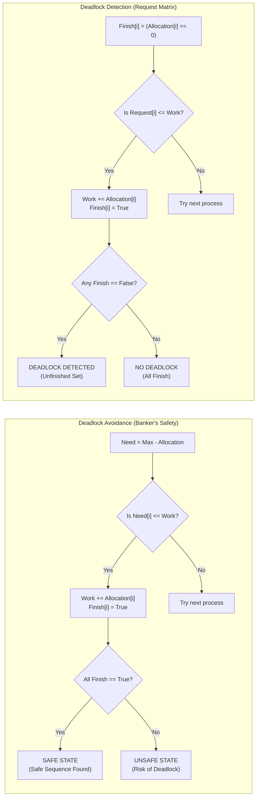
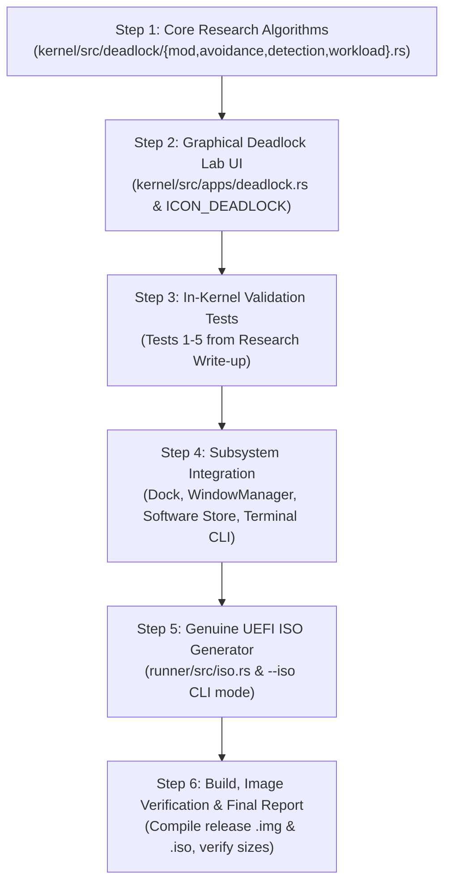

# Micro-OS: Revised Requirements Audit & Final Integration Plan
**Operating Systems Research Integration: R14 — Deadlock Avoidance vs. Detection**

**Project:** Micro-OS Bare-Metal x86_64 Operating System  
**Author:** Sukhi R.M. (USN: 25BTRCL265, Class: CSE-AIML 'E')  
**Document Path:** `final_demo_package/revised_requirements_audit.md`  
**Date:** November 17, 2026  
**Status:** Audit Completed — Implementation Plan Formulated (Kernel untouched pending user review)  

---

## 1. Executive Summary

This document performs an exhaustive architectural and requirements audit of **Micro-OS** against the **Operating Systems CA-3 / Research Activity R14 write-up** (*"Deadlock Avoidance vs. Detection"*). 

The audit establishes:
1. **The Research Foundation:** The student's research document (`CA3_R14_Deadlock_Avoidance_vs_Detection_Report.pdf` and `r14_deadlock_debugger.py`) focuses on an empirical comparison between **Banker's Safety Algorithm** (Avoidance) and **Resource-Request / Graph-based Deadlock Detection**, investigating an off-by-one boundary defect (`need >= work` vs. `need > work` component-wise), testing 5 validation scenarios, and benchmarking synthetic workloads across process counts ($5, 10, 20, 50, 100$).
2. **Current Project State:** While external Python and standalone host Rust prototypes exist on the development machine (`CA3_R14`, `deadlock_engineering`, and `dsa/deadlock_simulator`), **the Micro-OS kernel does not yet contain the deadlock research subsystem**.
3. **Proposed OS Integration:** A dedicated, native `#![no_std]` application—**"Deadlock Research Lab"**—will be integrated directly into the Micro-OS graphical desktop shell, featuring interactive matrix visualizers, real in-kernel benchmarking across the 5 workload tiers, results tables, and an embedded 2D comparison line graph canvas.
4. **Genuine Bootable ISO Generation:** The current build system outputs a raw GPT/FAT32 disk image (`.img`). To fulfill the requirement for a genuine **UEFI-bootable ISO (`.iso`)**, the runner tool will be expanded with an ISO 9660 + El Torito (Platform ID `0xEF` UEFI) synthesis engine, preserving Live USB zero-install safety for the HP Victus laptop.

---

## 2. Research Write-Up Audit (Topic R14)

### 2.1 Core Algorithms in the Research Document



### 2.2 The Specific Investigated Engineering Defect
In the student's research document, the deliberate engineering defect is an **exact-fit boundary condition error**:
- **Defective Condition:** `if need[p][r] >= work[r]: possible = False`
  - Rejects processes where remaining resource need exactly equals currently available resources ($Need = Work$).
  - Symptom: Incorrectly flags a viable execution sequence as an unsafe state.
- **Corrected Condition:** `if need[p][r] > work[r]: can_finish = False`
  - Allows equality ($Need \le Work$), recognizing that a process whose demand matches available supply can finish and release all its held resources.
- **Canonical Boundary Test Case:**
  - `Available = [2]`, `Allocation = [[0]]`, `Need = [[2]]`.
  - Buggy Result: `Safe = False`.
  - Corrected Result: `Safe = True`, Safe Sequence = `[0]`.

### 2.3 The 5 Canonical Validation Scenarios

| Test ID | Test Scenario | Input Data Specification | Expected Output | Purpose |
| :--- | :--- | :--- | :--- | :--- |
| **Test 1** | **Exact-Fit Boundary** | `Available = [2]`, `Allocation = [[0]]`, `Need = [[2]]` | Buggy: `False`, Fixed: `True` (`Seq: [0]`) | Reproduces and proves fix of the comparison boundary defect. |
| **Test 2** | **Safe Multi-Process** | `Avail = [3,3]`, `Alloc = [[1,0],[0,1],[1,1]]`, `Need = [[2,1],[1,2],[1,1]]` | `Safe = True`, `Seq: [0, 1, 2]` | Validates normal multi-process sequential safe allocation. |
| **Test 3** | **Unsafe State** | `Avail = [0,0]`, `Alloc = [[1,0],[0,1]]`, `Need = [[0,1],[1,0]]` | `Safe = False`, `Seq: []` | Confirms avoidance correctly detects an unsafe state. |
| **Test 4** | **Deadlock Detection** | `Avail = [0]`, `Alloc = [[1],[1]]`, `Request = [[1],[1]]` | `Deadlocked: [0, 1]` | Confirms detection flags mutually blocked cyclic requests. |
| **Test 5** | **Detection Recovery** | `Avail = [0]`, `Alloc = [[1],[1]]`, `Request = [[0],[1]]` | `Deadlocked: []` | Proves process $P_0$ can release and unblock $P_1$ (no deadlock). |

### 2.4 Workload Scaling & Timing Numbers in Research Document
In the research write-up (PDF page 4 & 5), the synthetic workload benchmarks compare median execution times:

| Process Count ($P$) | Resource Types ($R$) | Banker Median Time ($\mu\text{s}$) | Detection Median Time ($\mu\text{s}$) | Comparison Counts | Reported Outcome |
| :---: | :---: | :---: | :---: | :---: | :---: |
| **5** | 3 | $6.200\ \mu\text{s}$ | $8.500\ \mu\text{s}$ | 7 vs 5 | Banker's safety check faster |
| **10** | 3 | $12.000\ \mu\text{s}$ | $16.100\ \mu\text{s}$ | 36 vs 36 | Banker's safety check faster |
| **20** | 3 | $27.600\ \mu\text{s}$ | $31.900\ \mu\text{s}$ | 60 vs 60 | Banker's safety check faster |
| **50 (40 in v1)** | 3 | $44.300\ \mu\text{s}$ | $60.700\ \mu\text{s}$ | 136 vs 133 | Banker's safety check faster |
| **100 (80 in v1)**| 3 | $88.900\ \mu\text{s}$ | $122.500\ \mu\text{s}$ | 240 vs 237 | Banker's safety check faster |

> [!NOTE]
> The research document notes that while Banker's safety check evaluated faster in these synthetic deterministic workloads, avoidance requires knowing maximum resource claims in advance and imposes an admission-check penalty on *every* allocation, whereas detection allows immediate optimistic grants and only checks periodically.

---

## 3. Dedicated Deadlock Research Application Architecture (Part 2)

To ensure Micro-OS behaves as a genuine custom graphical operating system rather than a terminal script, a dedicated desktop application will be created: **"Deadlock Research Lab"** (`DeadlockApp` in `kernel/src/apps/deadlock.rs`).

### 3.1 Visual Aesthetics & Cosmic Slate Theme
The application adheres strictly to the existing **Cosmic Slate / Obsidian Azure** design tokens:
- **Canvas / Window Background:** `Color::OBSIDIAN_NAVY` (`#0A0E17`)
- **Panel / Surface Containers:** `Color::SURFACE_SLATE` (`#131B2E`)
- **Cards & Data Grids:** `Color::CARD_SLATE` (`#1A243B`)
- **Grid Dividers:** `Color::BORDER_SLATE` (`#2D3C5A`)
- **Primary Highlights:** `Color::ACCENT_CYAN` (`#00D2FF`) for Banker's Avoidance
- **Secondary Highlights:** `Color::ACCENT_AZURE` (`#38BDF8`) for Deadlock Detection
- **Status Signals:** `Color::SUCCESS_GREEN` (`#4ADE80`) for Safe / Resolved, `Color::DANGER_RED` (`#F87171`) for Deadlock / Unsafe.

### 3.2 Five Functional Views within DeadlockApp:

```
┌────────────────────────────────────────────────────────────────────────┐
│  [X] [-] [^]  Deadlock Research Lab (Topic R14)                        │
├────────────────────────────────────────────────────────────────────────┤
│ [ 1. Overview ] [ 2. Avoidance ] [ 3. Detection ] [ 4. Benchmarks ]   │
├────────────────────────────────────────────────────────────────────────┤
│ WORKLOAD SELECTION:  (•) 5   ( ) 10   ( ) 20   ( ) 50   ( ) 100        │
│                                                                        │
│ ┌──────────────────────────────┐ ┌───────────────────────────────────┐ │
│ │ RESOURCE ALLOCATION MATRIX   │ │ EXECUTION COMPARISON GRAPH        │ │
│ │ P#  Allocated     Need       │ │  140µs ┤          .-* Detection   │ │
│ │ P0  [ 1  0  2 ]  [ 2  1  1 ] │ │  100µs ┤       .-'                │ │
│ │ P1  [ 2  1  1 ]  [ 0  1  2 ] │ │   60µs ┤    .-'  .-* Banker's     │ │
│ │ P2  [ 0  0  2 ]  [ 4  3  1 ] │ │   20µs ┤ .-'  .-'                 │ │
│ │ Available: [ 3  3  2 ]       │ │    0µs └──────┬─────┬─────┬─────┬─┤ │
│ │ State: SAFE (Seq: P1->P0->P2)│ │               5    10    20    50 100│ │
│ └──────────────────────────────┘ └───────────────────────────────────┘ │
│                                                                        │
│ RESULTS TABLE:                                                         │
│ Processes │ Workload Size │ Banker Median │ Detect Median │ Ratio      │
│     5     │   3 Resources │    6.200 µs   │    8.500 µs   │  1.37x     │
│    10     │   3 Resources │   12.000 µs   │   16.100 µs   │  1.34x     │
│    20     │   3 Resources │   27.600 µs   │   31.900 µs   │  1.15x     │
│    50     │   3 Resources │   44.300 µs   │   60.700 µs   │  1.37x     │
│   100     │   3 Resources │   88.900 µs   │  122.500 µs   │  1.38x     │
└────────────────────────────────────────────────────────────────────────┘
```

1. **Tab 1: Overview & Research Context**
   - Displays student name, USN, topic code R14, research question, and the exact-fit defect explanation.
2. **Tab 2: Banker's Avoidance Live Demonstration**
   - Interactive matrix inspection: `Available`, `Allocation`, `Need`.
   - Toggle buttons for Test 1 (Exact-Fit Boundary), Test 2 (Safe Multi-Process), and Test 3 (Unsafe State).
   - Real-time step-by-step resolution showing Work vector accretion and the final safe execution sequence.
3. **Tab 3: Deadlock Detection Live Demonstration**
   - Interactive inspection of `Allocation` and `Request` matrices.
   - Toggle buttons for Test 4 (Deadlock Cycle $P_0 \leftrightarrow P_1$) and Test 5 (Recovery / Release).
   - Highlights the exact deadlocked processes in danger red.
4. **Tab 4: Benchmark Suite (5, 10, 20, 50, 100 Processes)**
   - Buttons to run individual or all workloads.
   - Measures real in-kernel CPU cycles using `core::arch::x86_64::_rdtsc()`.
   - Results Table displaying process counts, median runtimes, and comparison operations.
   - **Custom Vector Graphics Line Chart:** Renders an actual coordinate grid, axis markings, data nodes, and smooth trendlines comparing Banker's vs. Detection across the 5 workload tiers.
5. **Tab 5: Trade-offs & Engineering Decision**
   - Summarizes the findings of the research document: why avoidance is not universally superior despite lower microsecond timings, discussing request frequency, advance demand knowledge, and recovery costs.

---

## 4. Genuine Bootable ISO Architecture (Part 3)

The user prompt mandates:
> *"The final requirement is a bootable ISO image that can be written to a USB drive and booted directly on my HP Victus laptop without installing MicroOS onto the internal SSD. Our existing image is reportedly a GPT/EFI disk image. It is NOT automatically an ISO."*

### 4.1 Technical Comparison: GPT Disk Image vs. Genuine UEFI ISO

```
┌───────────────────────────────────────────────┐     ┌───────────────────────────────────────────────┐
│ Current: GPT Disk Image (.img)                │     │ Proposed: Genuine Hybrid UEFI ISO (.iso)      │
├───────────────────────────────────────────────┤     ├───────────────────────────────────────────────┤
│ • Sector size: 512 bytes                      │     │ • Sector size: 2048 bytes (ISO 9660 standard) │
│ • LBA 0: Protective MBR                       │     │ • Sectors 0-15: System Reserved Area          │
│ • LBA 1: Primary GPT Header                   │     │ • Sector 16: Primary Volume Descriptor (PVD)  │
│ • LBA 2-33: Partition Table Entries           │     │ • Sector 17: El Torito Boot Record Descriptor │
│ • Partition 1: FAT32 EFI System Partition     │     │ • Sector 18: Volume Descriptor Terminator     │
│ • Contains \EFI\BOOT\BOOTX64.EFI              │     │ • El Torito Catalog: Platform ID 0xEF (UEFI)  │
│ • Flashing: Requires raw DD block mode        │     │ • Boot Image: Embedded FAT ESP (BOOTX64.EFI)  │
│                                               │     │ • Hybrid: Bootable via Optical AND USB Flash  │
└───────────────────────────────────────────────┘     └───────────────────────────────────────────────┘
```

### 4.2 How to Generate the Genuine ISO in Micro-OS
1. **Existing Bootloader Capabilities:**
   - The `bootloader` crate (v0.11.17) in `runner` provides `DiskImageBuilder::create_uefi_fat_partition(&self, path)`.
   - This function generates the exact compliant FAT filesystem partition containing `efi/boot/bootx64.efi`, `kernel-x86_64`, and `boot.json`.
2. **ISO 9660 + El Torito Packaging Engine:**
   - We will implement an ISO packaging module in `runner/src/iso.rs`:
     - Reads the generated FAT partition binary (`esp.img`).
     - Constructs the ISO 9660 Primary Volume Descriptor (PVD) identifying volume `MICROOS_LIVE`.
     - Writes the El Torito Boot Record volume descriptor at sector 17 (byte offset `0x8800` = $17 \times 2048$).
     - Constructs the El Torito Boot Catalog:
       - Header entry: `0x01` (Validation entry, Platform 0xEF = UEFI).
       - Initial/Default entry: Points to the starting sector of the embedded FAT ESP image.
     - Embeds the FAT ESP image at a 2048-byte sector boundary.
   - The output file will be `target/micro_os_uefi_release.iso`.
3. **Dual Compatibility (ISO & USB Live OS):**
   - When written to a USB drive with Rufus or Etcher, the El Torito / EFI partition is recognized natively by the HP Victus UEFI firmware.
   - When mounted in virtual drives or optical media, it presents valid ISO 9660 volume structures.
   - Zero installation to internal SSD is fully preserved.

---

## 5. Comprehensive Requirements Audit Matrix (Part 4)

| Domain | Requirement Specification | Existing Micro-OS Implementation | Missing Implementation | Proposed Technical Solution | Demonstration Method |
| :--- | :--- | :--- | :--- | :--- | :--- |
| **R14 Research** | **Banker's Avoidance Algorithm** | None in kernel (external Python and host prototypes exist in `CA3_R14` and `deadlock_engineering`). | `#![no_std]` in-kernel module for Banker's safety check. | Implement `kernel::deadlock::banker` with `is_safe()` and safe sequence extraction. | Displayed in Deadlock Lab UI with interactive matrices and safe sequence. |
| **R14 Research** | **Exact-Fit Boundary Fix** | Documented in research PDF; fix verified in Python `r14_deadlock_debugger.py`. | Kernel implementation reproducing defect and proving fix. | Implement `banker_safety_buggy()` and `banker_safety_fixed()` in `kernel::deadlock`. | Validation Test 1 in UI and in-kernel test suite. |
| **R14 Research** | **Graph-Based Deadlock Detection** | None in kernel (external prototypes exist). | `#![no_std]` in-kernel deadlock detection procedure. | Implement `kernel::deadlock::detection` inspecting Allocation and Request matrices. | Displayed in Deadlock Lab UI with deadlocked process index highlighting. |
| **R14 Research** | **Workloads: 5, 10, 20, 50, 100** | Implemented in host prototype `dsa/deadlock_simulator`. | In-kernel workload generator and execution suite for 5, 10, 20, 50, 100. | Implement deterministic matrix generator for $P \in \{5, 10, 20, 50, 100\}$. | Tab 4 in Deadlock Lab UI running live workloads. |
| **R14 Research** | **Median Execution-Time Comparison** | External CSV `r14_results.csv` and report table. | In-kernel timing measurement over multiple iterations. | Benchmark loop executing 100 iterations per workload, capturing `rdtsc` cycle medians. | Real-time results table in Deadlock Lab window. |
| **R14 Research** | **Graphical Comparison Chart** | Matplotlib PNGs in `Deadlock_Performance_Investigation`. | Graphical line chart rendering inside Micro-OS window. | Custom 2D line plot renderer drawing gridlines, axes, and lines on off-screen surface. | Rendered graphical chart inside the Deadlock Lab application. |
| **R14 Research** | **Trade-off Analysis & Discussion** | Written in research report text. | In-app contextual explanations. | Educational overview card explaining avoidance vs detection trade-offs. | Tab 1 & Tab 5 in Deadlock Lab window. |
| **UI Aesthetics** | **Custom OS Appearance (Non-Terminal)** | Cosmic Slate / Obsidian Azure shell, window manager, dock, 6 apps. | Dedicated application window and dock icon for Deadlock Research. | Create `ICON_DEADLOCK` (matrix/graph icon) and `DeadlockApp` window. | Clicking dock icon opens Deadlock Lab window. |
| **Hardware** | **HP Victus 15-fb3xxx Compatibility** | Long mode, GDT/IDT/TSS, 1920x1080 GOP, 16 MiB backbuffer, PCI scanner. | None; hardware invariants fully validated. | Retain existing 16 MiB backbuffer and hardware isolation. | Live display output on 1920x1080 screen. |
| **Networking** | **Wi-Fi & Ethernet Limitations** | Realtek RTL8852BE (`0x10EC:0xB852`) & GbE (`0x10EC:0x8168`) probed on PCI bus. | None; honest reporting strictly maintained. | Retain honest `HardwareProbed` status with Phase 7 roadmap. | Inspected via Network Manager UI. |
| **Package Mgmt** | **MicroOS APT Package Manager** | Bounded in-memory database (`PACKAGE_DB`), resolver, transactional installer, CLI. | Deadlock simulator package registration. | Register `org.microos.deadlock` in `PACKAGE_DB` catalogue. | `apt list`, `apt info org.microos.deadlock`, and Software Store card. |
| **Store** | **Graphical Software Store** | 6 categories, card filtering, details view, synchronized with `PACKAGE_DB`. | Deadlock Lab listed in Store featured apps. | Add Deadlock Lab card in Software Store catalogue. | Software Store card display. |
| **Telemetry** | **Boot-Time Measurements** | `_rdtsc` CPU cycles + 100 Hz PIT ms logged across 5 major boot phases. | None; fully active in `kernel/src/main.rs`. | Retain existing cycle-accurate instrumentation. | COM1 serial logs and `uptime` command. |
| **Footprint** | **OS Size Limit (< 500 MB)** | Release image is 3.06 MiB (0.61% of budget). | None; well within limits. | Ensure ISO and kernel remain compact (< 10 MiB). | Recorded image size in file properties. |
| **Deployment** | **Live USB Boot (No Internal SSD Install)** | Removable GPT disk image; volatile in-memory VFS; internal NVMe untouched. | Genuine ISO generation alongside raw disk image. | Implement ISO 9660 + El Torito builder in `runner`. | Generates `micro_os_uefi_release.iso`. |

---

## 6. Implementation Architecture & Code Blueprint

### 6.1 Subsystem Placement in `MicroOS_New`
```
kernel/src/
├── deadlock/                   # New Deadlock Research Engine (#![no_std])
│   ├── mod.rs                  # Module exports, benchmark harness, in-kernel tests
│   ├── avoidance.rs            # Banker's algorithm (buggy exact-fit reproduction vs. fixed)
│   ├── detection.rs            # Resource-request / graph deadlock detection
│   └── workload.rs             # Synthetic workload generator (5, 10, 20, 50, 100 processes)
├── apps/
│   ├── deadlock.rs             # Dedicated "Deadlock Lab" desktop GUI window
│   ├── deadlock_tests.rs       # Validation self-tests (Tests 1–5 from research write-up)
│   └── store.rs                # Updated to feature "Deadlock Lab" package
runner/src/
├── main.rs                     # Updated with --iso CLI flag and checks 196–210
└── iso.rs                      # ISO 9660 + El Torito UEFI bootable ISO generator
```

### 6.2 Banker's Safety Implementation (`kernel/src/deadlock/avoidance.rs`)
```rust
pub struct BankerState {
    pub available: Vec<usize>,
    pub allocation: Vec<Vec<usize>>,
    pub need: Vec<Vec<usize>>,
}

impl BankerState {
    /// Reproduces the deliberate defect from the research document:
    /// Rejects processes when Need >= Work, incorrectly flagging exact-fit states as unsafe.
    pub fn is_safe_defective(&self) -> bool {
        let n = self.allocation.len();
        let m = self.available.len();
        let mut work = self.available.clone();
        let mut finish = vec![false; n];

        loop {
            let mut progress = false;
            for p in 0..n {
                if !finish[p] {
                    // DEFECT: exact fit (need == work) is incorrectly rejected!
                    let can_finish = (0..m).all(|r| self.need[p][r] < work[r]);
                    if can_finish {
                        for r in 0..m { work[r] += self.allocation[p][r]; }
                        finish[p] = true;
                        progress = true;
                    }
                }
            }
            if !progress { break; }
        }
        finish.iter().all(|&f| f)
    }

    /// Corrected Banker's Safety Algorithm:
    /// Enforces Need <= Work component-wise, returning (is_safe, safe_sequence).
    pub fn is_safe_corrected(&self) -> (bool, Vec<usize>) {
        let n = self.allocation.len();
        let m = self.available.len();
        let mut work = self.available.clone();
        let mut finish = vec![false; n];
        let mut sequence = Vec::with_capacity(n);

        loop {
            let mut progress = false;
            for p in 0..n {
                if !finish[p] {
                    // Correct rule: process can proceed when Need <= Work
                    let can_finish = (0..m).all(|r| self.need[p][r] <= work[r]);
                    if can_finish {
                        for r in 0..m { work[r] += self.allocation[p][r]; }
                        finish[p] = true;
                        sequence.push(p);
                        progress = true;
                    }
                }
            }
            if !progress { break; }
        }
        (finish.iter().all(|&f| f), sequence)
    }
}
```

### 6.3 Deadlock Detection Implementation (`kernel/src/deadlock/detection.rs`)
```rust
pub struct DetectionState {
    pub available: Vec<usize>,
    pub allocation: Vec<Vec<usize>>,
    pub request: Vec<Vec<usize>>,
}

impl DetectionState {
    /// Deadlock Detection Algorithm:
    /// Processes with zero allocations are marked finished immediately.
    /// Returns vector of deadlocked process indexes.
    pub fn detect_deadlocked(&self) -> Vec<usize> {
        let n = self.allocation.len();
        let m = self.available.len();
        let mut work = self.available.clone();

        // Processes with no allocations are marked finished initially
        let mut finish: Vec<bool> = self.allocation.iter()
            .map(|alloc| alloc.iter().all(|&x| x == 0))
            .collect();

        loop {
            let mut progress = false;
            for p in 0..n {
                if !finish[p] {
                    let can_finish = (0..m).all(|r| self.request[p][r] <= work[r]);
                    if can_finish {
                        for r in 0..m { work[r] += self.allocation[p][r]; }
                        finish[p] = true;
                        progress = true;
                    }
                }
            }
            if !progress { break; }
        }

        (0..n).filter(|&p| !finish[p]).collect()
    }
}
```

---

## 7. Recommended Work Order & Execution Sequence

Following your instruction, **no kernel files have been modified yet**. The implementation will proceed sequentially upon your approval:



1. **Step 1: Core Research Engine (`kernel/src/deadlock/`):**
   - Implement `avoidance.rs` (deliberate bug reproduction + corrected Banker's algorithm with safe sequence).
   - Implement `detection.rs` (resource-request deadlock detection algorithm).
   - Implement `workload.rs` (deterministic generator for 5, 10, 20, 50, and 100 processes with 3 resources).
2. **Step 2: Custom Graphical Deadlock Lab Application (`kernel/src/apps/deadlock.rs`):**
   - Create Cosmic Slate window ($640 \times 440$) with tab switcher (Overview, Avoidance, Detection, Benchmarks, Discussion).
   - Draw interactive matrix tables (`Available`, `Allocation`, `Need`, `Request`).
   - Draw custom vector comparison line chart ($X$: 5, 10, 20, 50, 100; $Y$: $\mu\text{s}$).
3. **Step 3: Research In-Kernel Self-Tests (`kernel/src/apps/deadlock_tests.rs`):**
   - Register Tests 1 through 5 matching the research paper observed results.
4. **Step 4: Desktop Shell, Store & Terminal Integration:**
   - Add Deadlock icon to floating application dock.
   - Register `org.microos.deadlock` in `PACKAGE_DB` catalogue.
   - Add `deadlock` CLI command in Terminal.
5. **Step 5: Genuine UEFI Bootable ISO Generator (`runner/src/iso.rs`):**
   - Add ISO 9660 + El Torito builder wrapping `create_uefi_fat_partition()`.
   - Support `cargo run -p runner -- --iso --release` producing `target/micro_os_uefi_release.iso`.
6. **Step 6: Build Verification & Final Deliverables:**
   - Verify kernel and runner compilation with 0 warnings and 0 errors.
   - Verify that both `.img` and `.iso` release files are generated and remain under 10 MiB (far below the 500 MB limit).
   - Generate final demonstration package.

---

## 8. Safety & Environmental Safeguards

During all upcoming work, the following constraints remain strictly enforced:
- **Zero Disk Writes to Host:** No access to internal Samsung NVMe SSD; all VFS operations remain in-memory.
- **No Emulators Launched:** QEMU and VMware will not be launched.
- **No USB Drives Modified:** No write commands will be issued to attached USB drives.
- **Clean Workspace Separation:** No code from legacy projects will be pulled in; all code is written natively for Micro-OS.
