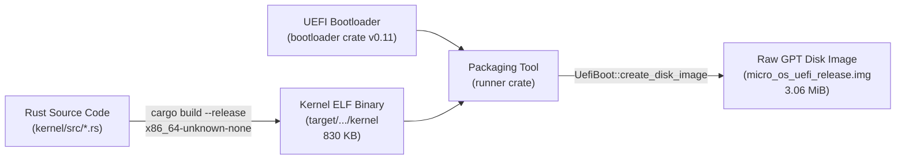

# Micro-OS: Live USB Deployment & Architecture Guide

**Project:** Micro-OS Bare-Metal x86_64 Kernel  
**Date:** November 17, 2026  
**Target Platform:** HP Victus 15-fb3xxx Laptop  
**Image Artifact:** `target/micro_os_uefi_release.img` (3,211,264 bytes / 3.06 MiB)  

---

## 1. How Source Code Becomes a Bootable UEFI Image

A common misconception in OS development is that any operating system installer or live image is an "ISO". In reality, modern UEFI hardware does not boot from optical disc structures unless running legacy El Torito emulation. 

Micro-OS produces a **raw GUID Partition Table (GPT) disk image** (`.img`), designed specifically for block-level flashing to USB flash drives and SSDs.

### The 4-Stage Compilation & Packaging Pipeline:



1. **Stage 1: Bare-Metal Compilation (`kernel`)**
   - The Rust compiler (`rustc` nightly) compiles the `#![no_std]` kernel for target `x86_64-unknown-none`.
   - The output is a standard 64-bit ELF binary containing `.text` (machine code), `.rodata` (constants and icons), `.data` (initialized globals), and `.bss` (uninitialized variables).
   - In release mode with Link-Time Optimization (LTO) and dead code elimination, the compiled ELF binary is **830,344 bytes (~810 KiB)**.

2. **Stage 2: UEFI Bootloader Stage (`bootloader` crate)**
   - Micro-OS utilizes `bootloader_api` (v0.11), which provides the pre-compiled UEFI application binary `BOOTX64.EFI`.
   - `BOOTX64.EFI` is written in Rust and targets `x86_64-unknown-uefi`. It interacts directly with UEFI firmware services (`BS` - Boot Services, `RS` - Runtime Services).

3. **Stage 3: Disk Image Generation (`runner`)**
   - The host tool (`runner`) synthesizes a raw disk image file on the host filesystem.
   - It constructs a **Protective MBR** at LBA 0 (identifying partition type `0xEE` so legacy tools recognize it as GPT).
   - It writes the **Primary GPT Header** at LBA 1 and **Partition Entry Array** at LBAs 2–33.
   - It formats the EFI System Partition (ESP) as a **FAT32** filesystem.
   - It copies `BOOTX64.EFI` to the canonical UEFI removable media boot path: `\EFI\BOOT\BOOTX64.EFI`.
   - It embeds the compiled kernel ELF into the filesystem alongside the boot configuration.
   - It writes the **Secondary (Backup) GPT Header** at the end of the image.

4. **Stage 4: Output Disk Image**
   - The resulting file is `target/micro_os_uefi_release.img` with an exact size of **3,211,264 bytes (3.06 MiB)**.

---

## 2. Why the Image is NOT an ISO

| Characteristic | Raw GPT Disk Image (`.img`) | Optical Disc Image (`.iso`) |
| :--- | :--- | :--- |
| **Target Media** | USB Flash Drives, Hard Drives, SSDs | CD-ROM, DVD-ROM, Blu-ray |
| **Filesystem Standard** | GPT + FAT32 (EFI System Partition) | ISO 9660 / Joliet / UDF |
| **Sector Addressing** | 512-byte Logical Block Addressing (LBA) | 2048-byte optical data sectors |
| **Boot Mechanism** | Direct UEFI firmware FAT driver reading `\EFI\BOOT\BOOTX64.EFI` | El Torito boot record with boot catalog and emulation pointers |
| **Flashing Requirement** | Raw block-level byte copy (`dd`, Rufus DD mode, Etcher) | Optical burning or "hybrid ISO" isohybrid post-processing |

> [!IMPORTANT]
> Do not attempt to burn `micro_os_uefi_release.img` using software expecting an optical ISO format unless written in **raw block / DD mode**. Renaming `.img` to `.iso` will cause optical burners to reject the file because it contains a GPT partition table rather than an ISO 9660 Volume Descriptor.

---

## 3. GPT Layout & Physical Drive Geometry

When `micro_os_uefi_release.img` (3.06 MiB) is written byte-for-byte to a typical physical USB drive (e.g., an 8 GB, 16 GB, or 32 GB drive), the disk geometry is laid out as follows:

```
Physical USB Flash Drive (e.g., 16 GB)
┌────────────┬─────────────────────────────┬────────────────────────────────────────────────────────┐
│ LBA 0      │ LBA 1-33                    │ LBA 2048 .. 6271 (3.06 MiB)    │ LBA 6272 .. End (Unallocated)          │
├────────────┼─────────────────────────────┼────────────────────────────────┼────────────────────────────────────────┤
│ Protective │ Primary GPT Header &        │ EFI System Partition (FAT32)   │ Remainder of physical USB drive        │
│ MBR (0xEE) │ Partition Table Entries     │ contains \EFI\BOOT\BOOTX64.EFI │ (Unused; does not affect boot)         │
└────────────┴─────────────────────────────┴────────────────────────────────┴────────────────────────────────────────┘
```

### The Backup GPT Header Question:
- Under strict GPT specifications, a backup copy of the GPT header is written at the final LBA of the physical medium.
- Because the generated image is ~3.06 MiB, its backup GPT is positioned at the end of the 3.06 MiB image rather than at the end of a 16 GB physical thumb drive.
- **Does this prevent booting?** **NO.** The UEFI specification (Version 2.10, Section 5.3.1) requires firmware to parse the Primary GPT Header at LBA 1. The backup GPT header is only consulted if the primary header is corrupted. The HP Victus UEFI firmware reads LBA 1, successfully locates the ESP, and boots without error.

---

## 4. USB Flashing Instructions (Windows 11)

To prepare a bootable Live USB drive from Windows 11 without corrupting internal storage:

### Method A: Rufus (Recommended)
1. Download and run **Rufus** (portable version).
2. Insert your USB thumb drive (any drive $\ge 64\text{ MB}$).
3. In Rufus:
   - **Device:** Select your USB thumb drive carefully. *(Double check drive letter to ensure you do not select an external backup drive!)*
   - **Boot selection:** Click `SELECT` and browse to `C:\Users\sukhi\OneDrive\Documents\MicroOS_New\target\micro_os_uefi_release.img`.
     *(Tip: Change file type filter in file dialog to "All Files (*.*)" to see `.img` files).*
   - **Partition scheme:** GPT.
   - **Target system:** UEFI (non-CSM).
4. Click `START`.
5. If prompted with a dialog regarding "Write in ISO Image mode" vs **"Write in DD Image mode"**, select **Write in DD Image mode**.
6. Rufus will write the exact byte blocks to the USB drive in under 5 seconds.

### Method B: Balena Etcher
1. Open **Balena Etcher**.
2. Click **Flash from file** and select `target/micro_os_uefi_release.img`.
3. Select your USB drive as the target.
4. Click **Flash!**.

---

## 5. Physical HP Victus Boot Procedure

Follow these exact steps to boot Micro-OS on the physical HP Victus 15-fb3xxx laptop:

### Step 1: Disable Secure Boot (One-Time Setup)
Because Micro-OS is an independent educational operating system, its `BOOTX64.EFI` binary is compiled locally and not signed with Microsoft's 3rd Party UEFI CA certificate.
1. Insert the prepared USB drive into one of the USB-A ports on the HP Victus.
2. Power on the laptop and immediately tap the **F10** key repeatedly until the **HP BIOS Setup Utility** opens.
3. Use the arrow keys to navigate to **Security** or **Advanced** -> **Boot Options**.
4. Scroll to **Secure Boot** and press Enter -> Set to **Disabled**.
5. Ensure **USB Boot** is set to **Enabled**.
6. Ensure **Legacy USB Support** is set to **Enabled** (ensures external USB keyboards and mice work via 8042 emulation).
7. Press **F10** to save changes and select **Yes** to exit.
8. If the laptop prompts on reboot to confirm disabling Secure Boot (e.g. *"Operating System Boot Mode Change: Enter 4-digit code + Enter"*), type the displayed code and press Enter.

### Step 2: Boot Micro-OS via F9 Boot Menu
1. Power on the laptop and immediately tap the **F9** key repeatedly.
2. The **Boot Device Options** menu will appear, displaying:
   - `OS Boot Manager (Samsung NVMe SSD)`
   - `USB Hard Drive (UEFI) - [Your USB Flash Drive Name]`
3. Highlight the **USB Hard Drive (UEFI)** entry and press **Enter**.
4. The screen will display:
   - UEFI GOP linear framebuffer initialization (1920x1080 Full HD).
   - Cosmic Slate deep navy desktop background with top status bar and floating dock.
   - Active **File Manager** application window focused in the center.
   - Keyboard and mouse pointer responsive.

### Step 3: Clean Exit
- When you are finished with the physical demonstration, simply click the power icon in the top status bar or press the laptop power button.
- Unplug the USB drive and power on normally. The HP Victus will immediately boot back into Windows 11 with all personal files, NVMe partitions, and settings 100% untouched.
