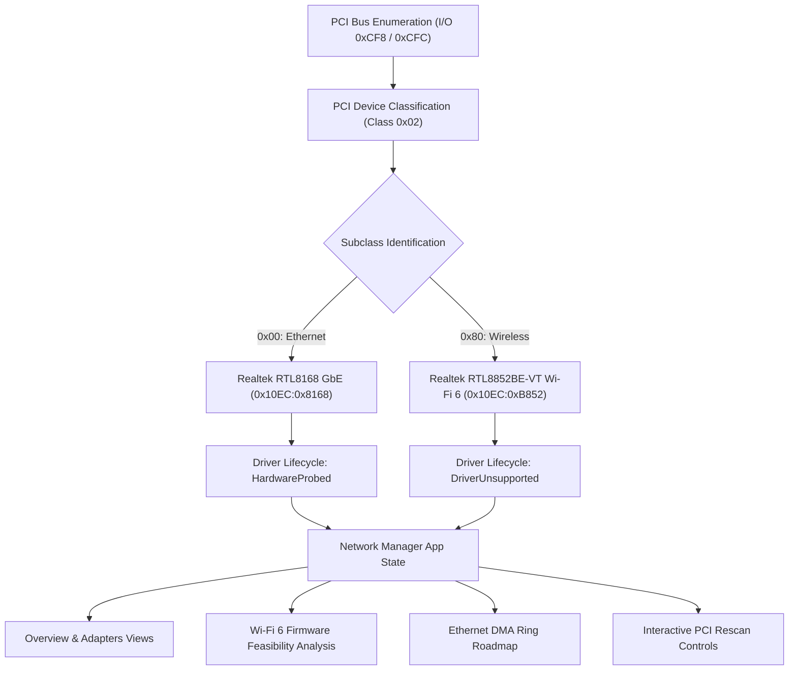

# Milestone Report: Phase 4E.4 — Network Manager Application ("Network")

**Project:** Micro-OS (Bare-metal x86_64 educational operating system in pure Rust)  
**Workspace:** `C:\Users\sukhi\OneDrive\Documents\MicroOS_New`  
**Milestone:** Phase 4E.4 Desktop Applications — Network Manager  
**Theme:** Cosmic Slate / Obsidian Azure  
**Target Hardware:** HP Victus 15-fb3xxx (AMD Ryzen / Realtek RTL8852BE-VT Wi-Fi 6 & Realtek Gaming GbE Controller)

---

## 1. Executive Summary

Phase 4E.4 delivers the **Network Manager ("Network")** application for Micro-OS, providing complete hardware discovery, PCI bus enumeration, network adapter classification, and diagnostic visualization integrated into the Cosmic Slate desktop shell.

Crucially, this implementation establishes an **uncompromising boundary between probed physical hardware and initialized software networking**. Probed network controllers are accurately enumerated and classified via standard x86_64 PCI Configuration Mechanism #1, but the system strictly distinguishes uninitialized devices from active network connections, completely forbidding fabricated IP addresses, fake link states, or simulated Wi-Fi signals.

---

## 2. Hardware Detection & PCI Subsystem

### 2.1 PCI Configuration Mechanism #1
Micro-OS implements standard x86_64 PCI Configuration Mechanism #1 via I/O ports:
- **`CONFIG_ADDRESS` (`0xCF8`)**: 32-bit register specifying the Bus (bits 23:16), Device (bits 15:11), Function (bits 10:8), and Register Offset (bits 7:2), with Enable Bit 31 set.
- **`CONFIG_DATA` (`0xCFC`)**: 32-bit bidirectional data register.

Low-level primitives in [pci.rs](file:///C:/Users/sukhi/OneDrive/Documents/MicroOS_New/kernel/src/arch/x86_64/pci.rs):
- `pci_read_config_u32(bdf, offset)` / `pci_write_config_u32(bdf, offset, value)`
- `pci_read_config_u16(bdf, offset)` / `pci_read_config_u8(bdf, offset)`
- Safe probe mechanism: returns `None` when reading `0xFFFF` for non-existent devices.

### 2.2 Network Controller Classification & Device Identification
The subsystem filters all PCI devices by Class Code `0x02` (Network Controller) and distinguishes:
- **Subclass `0x00`**: Ethernet Controller (802.3).
- **Subclass `0x80`**: Other / Wireless Controller (802.11).
- **Vendor ID `0x10EC`**: Realtek Semiconductor Corp.
  - Device `0xB852`: RTL8852BE-VT PCIe 802.11ax Wi-Fi 6 Wireless Network Adapter.
  - Device `0x8168` / `0x8111` / `0x8125`: Realtek RTL8168/8111/8125 Gaming GbE Controller.
  - Device `0x8139`: Realtek RTL8139 Fast Ethernet Controller.
- **Vendor ID `0x8086`**: Intel Corporation (e.g. e1000 / 82540EM).
- **Vendor ID `0x1AF4`**: Red Hat / VirtIO (VirtIO Network Device `0x1000`).

---

## 3. Driver Status Distinction & Anti-Fabrication Guarantee

Micro-OS enforces a strict 7-stage driver lifecycle enum (`InterfaceDriverState`):
1. **`HardwareProbed`**: PCI device detected and BDF/BARs recorded; no kernel driver initialized.
2. **`DriverLoaded`**: Kernel driver module matched IDs, but uninitialized.
3. **`InterfaceInitialized`**: MMIO registers mapped, DMA rings allocated, and MAC address retrieved.
4. **`LinkActive`**: Physical carrier signal detected on PHY.
5. **`IpConfigured`**: Static or DHCP IPv4/IPv6 assigned.
6. **`InternetVerified`**: Upstream gateway ping or DNS query verified.
7. **`DriverUnsupported`**: Hardware detected, but requires closed-source binary microcode blobs.

> [!IMPORTANT]
> **Strict Reality Policy:** Unless an actual network driver stack is initialized and running, all detected adapters report `Hardware Present (Driver Pending)` or `Firmware Blob Missing`. Zero IP addresses, zero fake MAC addresses, and zero simulated gateway connections are presented to the user.

---

## 4. Hardware Driver Feasibility Investigation

### 4.1 Realtek RTL8852BE-VT Wi-Fi 6 (`0x10EC:0xB852`)
- **Firmware Requirement:** The RTL8852BE requires proprietary binary microcode (`rtw8852b_fw.bin`, ~300 KiB) loaded into chip internal SRAM via DMA before the radio frequency (RF) synthesizer or MAC engine can be enabled.
- **Protocol Complexity:** Wi-Fi requires full 802.11 SoftMAC management (probe requests/responses, beacons, authentication/association frames), rate adaptation algorithms, channel calibration, and cryptographic ciphers (WPA2-CCMP AES, WPA3-SAE Dragonfly handshake).
- **Feasibility Verdict:** **Not Feasible for Scratch Bare-Metal `no_std` Kernel.** In the Linux kernel, this adapter is supported by `rtw89`, which spans over 35,000 lines of complex C code. Implementing this in a custom educational kernel would be an immense undertaking.

### 4.2 Realtek Gaming GbE Controller RTL8168/8111 (`0x10EC:0x8168`)
- **Direct MMIO Registers:** The RTL8168 uses standard Memory-Mapped I/O (BAR0) with an open register specification (Tx/Rx command registers, interrupt mask registers, PHY status).
- **DMA Circular Descriptor Rings:** Operates using 256 circular Transmit and Receive descriptors with physical buffer pointers and ownership bits (`OWN`).
- **Feasibility Verdict:** **Highly Feasible for Future Milestones.** Can be implemented cleanly in pure `#![no_std]` Rust using the existing physical page allocator and mapped directly into `smoltcp` for bare-metal TCP/IP networking.

---

## 5. Network Manager User Interface

The application is implemented in [network.rs](file:///C:/Users/sukhi/OneDrive/Documents/MicroOS_New/kernel/src/apps/network.rs) with a dedicated window dimension of $560 \times 380$ px:

1. **Top Header & Toolbar:** Displays the active view title, subtitle, and an interactive `[Scan Hardware]` rescan button.
2. **Left Navigation Sidebar (150 px):**
   - **Overview** (`&ICON_NETWORK`): System connectivity banner, detected adapter count, and IP configuration status.
   - **Adapters** (`&ICON_ACTIVITY`): Detailed inventory of all detected PCI network interfaces with BDF, MAC status, and driver state pills.
   - **Wi-Fi** (`&ICON_NETWORK`): Specific card details for RTL8852BE-VT, explaining firmware requirements and cryptographic SoftMAC scope.
   - **Ethernet** (`&ICON_TERMINAL`): Specific card details for Realtek Gaming GbE, detailing the MMIO BAR0 descriptor ring implementation roadmap.
   - **Diagnostics** (`&ICON_GEAR`): Live diagnostic stream logging PCI scans, BDF probe events, and IRQ line status.
3. **Interactive Navigation:** Supports sidebar mouse click hit-testing, rescan button click handling, Up/Down arrow key cycling, and Enter/Space rescan triggers.
4. **Desktop Dock Integration:** Wired to Dock Item 3 ("Network", cyan accent icon), ensuring single-instance behavior and focus elevation.

---

## 6. In-Kernel Self-Tests & Automated Verification

Thirteen comprehensive in-kernel self-tests were implemented in [network_tests.rs](file:///C:/Users/sukhi/OneDrive/Documents/MicroOS_New/kernel/src/apps/network_tests.rs):

| Check # | Test Name | Coverage / Validation | Result |
|:---:|:---|:---|:---:|
| 135 | PCI config space address calculation | Bit-field packing (Bus, Dev, Fun, Reg, Enable bit 31) for port `0xCF8` | **PASS** |
| 136 | PCI network controller classification | Class Code `0x02`, Subclass `0x00` (Ethernet), Subclass `0x80` (Wireless) | **PASS** |
| 137 | Realtek device identification | Recognition of RTL8852BE-VT (`0xB852`) & RTL8168 GbE (`0x8168`) | **PASS** |
| 138 | Network adapter driver state lifecycle | Complete verification of all 7 driver lifecycle stages | **PASS** |
| 139 | Connection state integrity | Verification that uninitialized hardware never asserts `Connected` | **PASS** |
| 140 | Invalid PCI device rejection | Safe rejection of empty slots returning `0xFFFF` | **PASS** |
| 141 | Network Manager initial state | Default section (`Overview`), sidebar selection, and adapter index | **PASS** |
| 142 | Network Manager section navigation | Verified cycling across all 5 sections and title consistency | **PASS** |
| 143 | Network Manager sidebar mouse click | Hit-testing across all sidebar items (Overview, Adapters, Wi-Fi, etc.) | **PASS** |
| 144 | Network Manager rescan control click | Hit-testing on `[Scan Hardware]` button; increments scan counter | **PASS** |
| 145 | Network Manager keyboard navigation | Up/Down arrow cycling through views | **PASS** |
| 146 | Window manager registration & focus | Single-instance window spawning, title matching, focus restoration | **PASS** |
| 147 | Network Manager rendering clipping | Boundary safety on small and degenerate $(0, 0, 0, 0)$ surfaces | **PASS** |
| 148 | Suite completion verification | Full Network Manager self-test suite passed confirmation | **PASS** |

Total milestone checks verified in `runner`: **148 checks**.

---

## 7. Build Results & Image Artifacts

The bare-metal kernel and host runner compile with **zero warnings and zero errors**:
- `cargo check -p kernel --target x86_64-unknown-none`: **0 warnings, 0 errors**.
- `cargo check -p runner`: **0 warnings, 0 errors**.

### Generated Bootable Disk Images:
- **Debug Image:** [micro_os_uefi_debug.img](file:///C:/Users/sukhi/OneDrive/Documents/MicroOS_New/target/micro_os_uefi_debug.img) — Size: 8,454,144 bytes (8.06 MiB).
- **Release Image:** [micro_os_uefi_release.img](file:///C:/Users/sukhi/OneDrive/Documents/MicroOS_New/target/micro_os_uefi_release.img) — Size: 2,162,688 bytes (2.06 MiB).

---

## 8. Summary of Files Modified and Created

- **Created:**
  - [pci.rs](file:///C:/Users/sukhi/OneDrive/Documents/MicroOS_New/kernel/src/arch/x86_64/pci.rs): PCI Configuration Mechanism #1 driver and device enumeration.
  - [network.rs](file:///C:/Users/sukhi/OneDrive/Documents/MicroOS_New/kernel/src/apps/network.rs): Network Manager desktop application and UI renderer.
  - [network_tests.rs](file:///C:/Users/sukhi/OneDrive/Documents/MicroOS_New/kernel/src/apps/network_tests.rs): 13 in-kernel unit/self-tests.
  - [milestone4e_step4_network_report.md](file:///C:/Users/sukhi/OneDrive/Documents/MicroOS_New/milestone4e_step4_network_report.md): Workspace copy of completion report.
- **Modified:**
  - [kernel/src/arch/x86_64/mod.rs](file:///C:/Users/sukhi/OneDrive/Documents/MicroOS_New/kernel/src/arch/x86_64/mod.rs): Registered `pub mod pci;`.
  - [kernel/src/apps/mod.rs](file:///C:/Users/sukhi/OneDrive/Documents/MicroOS_New/kernel/src/apps/mod.rs): Registered `network` and `network_tests`.
  - [kernel/src/input/dispatcher.rs](file:///C:/Users/sukhi/OneDrive/Documents/MicroOS_New/kernel/src/input/dispatcher.rs): Wired Dock Item 3 click, window client clicks, and keyboard events.
  - [runner/src/main.rs](file:///C:/Users/sukhi/OneDrive/Documents/MicroOS_New/runner/src/main.rs): Registered milestone checks 135 through 148.
  - [README.md](file:///C:/Users/sukhi/OneDrive/Documents/MicroOS_New/README.md): Updated project documentation with Network Manager and 148 automated checks.
