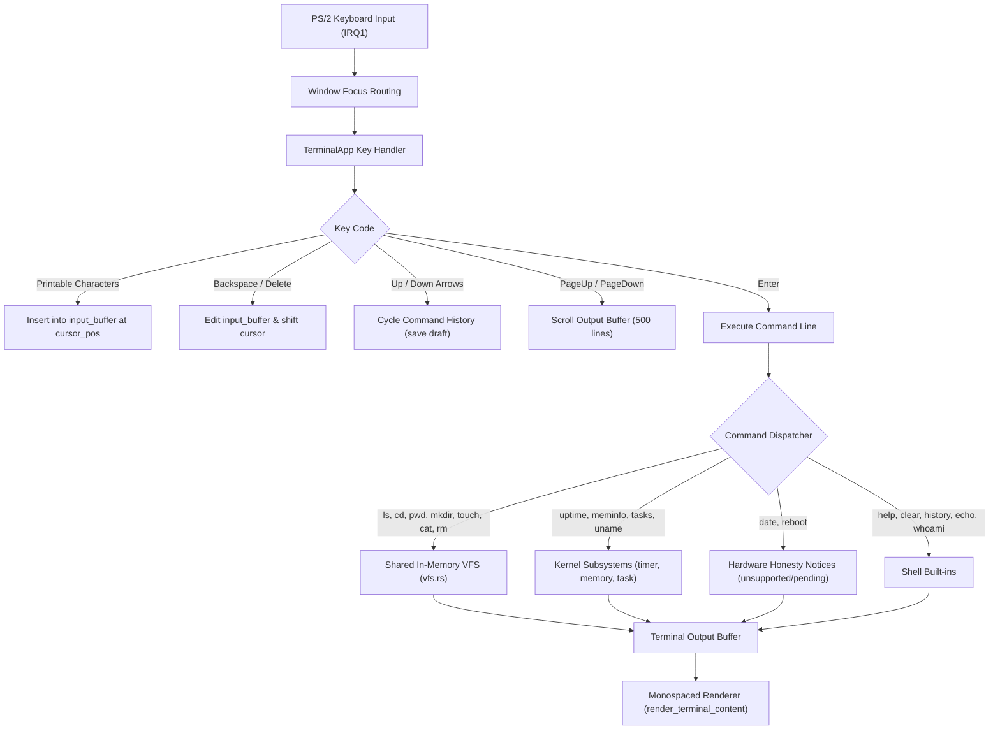

# Milestone Report: Phase 4E.5 — Terminal Application ("Terminal")

**Project:** Micro-OS (Bare-metal x86_64 educational operating system in pure Rust)  
**Workspace:** `C:\Users\sukhi\OneDrive\Documents\MicroOS_New`  
**Milestone:** Phase 4E.5 Desktop Applications — Terminal Emulator & Shell  
**Theme:** Cosmic Slate / Obsidian Azure  
**Target Hardware:** HP Victus 15-fb3xxx (AMD Ryzen x86_64 Long Mode, UEFI GOP Framebuffer)

---

## 1. Executive Summary

Phase 4E.5 delivers the **Terminal ("Terminal")** application for Micro-OS, providing an interactive graphical shell matching the Cosmic Slate / Obsidian Azure aesthetic.

The terminal emulator combines an interactive command-line editor (with cursor positioning, backspace, and history navigation) with direct integration into the shared in-memory Virtual File System (VFS) and real kernel telemetry subsystems. All commands interact with actual kernel structures; zero fake statistics or fabricated time readings are emitted.

---

## 2. Visual Design & Shell Architecture

The Terminal application is implemented in [terminal.rs](file:///C:/Users/sukhi/OneDrive/Documents/MicroOS_New/kernel/src/apps/terminal.rs) and configured with window dimensions of $580 \times 360$ px (minimum size $440 \times 260$ px):

1. **Obsidian Terminal Canvas:** Deep dark canvas background (`Color::new(10, 14, 22)`), providing high contrast against colored text glyphs.
2. **Cyan Shell Prompt:** Formatted dynamically based on current working directory:
   - At `/home/user`: `user@micro-os:~$ ` in `Color::ACCENT_CYAN`.
   - In subdirectories (e.g. `/home/user/Documents`): `user@micro-os:~/Documents$ `.
   - In root/system paths (e.g. `/sys`): `user@micro-os:/sys$ `.
3. **Monospaced Typography:** Leverages standard 8x8 bitmap glyphs at scale 1 (8px width, 10px line height), rendering up to 70 columns and 31 lines simultaneously.
4. **Interactive Text Cursor:** Renders a solid cyan cursor block at the active insertion point. If a character exists under the cursor, it is drawn in inverse dark color for visibility.
5. **Output Scrollback & Visual Scrollbar:** Supports up to 500 lines of scrollback memory. When output exceeds the visible client height, a slim vertical scrollbar track and cyan/azure thumb render along the right border.

---

## 3. Virtual File System (VFS) Integration

The Terminal application directly interfaces with the global in-memory Virtual File System (`VFS` in [vfs.rs](file:///C:/Users/sukhi/OneDrive/Documents/MicroOS_New/kernel/src/fs/vfs.rs)):
- **Tilde & Path Expansion:** Automatically expands `~` and `~/` to `/home/user`.
- **Bidirectional Desktop Integration:** Any directory created (`mkdir`) or file created (`touch`, `create_file`) or deleted (`rm`) in the Terminal is **instantly reflected in the File Manager ("Files")** and vice-versa, since both applications share the same underlying `VFS` instance.
- **Volatile Storage Transparency:** All help outputs and banners explicitly declare that the filesystem is in-memory and volatile across reboots.

---

## 4. Built-in Commands & Telemetry Integration

The shell implements 18 distinct commands with strict hardware honesty:

| Command | Usage | Description & Data Source |
|:---|:---|:---|
| `help` | `help` | Lists all built-in commands with concise usage and VFS volatility notes. |
| `clear` | `clear` | Clears terminal output lines and resets vertical scroll. |
| `ls` | `ls [path]` | Lists files and directories in current working directory or `path`. Distinguishes directories (`<DIR>` in cyan) and files (size in bytes in white). |
| `cd` | `cd [path]` | Changes current working directory. Supports `..`, `.`, absolute paths, relative paths, and tilde `~`. Validates directory existence. |
| `pwd` | `pwd` | Prints current working directory canonical path. |
| `mkdir` | `mkdir <dir>...` | Creates one or more directories in VFS. Rejects duplicate names. |
| `touch` | `touch <file>...` | Creates empty files in VFS or touches existing files. |
| `cat` | `cat <file>...` | Reads and prints UTF-8 text file content. Validates file existence and prevents directory reads. |
| `rm` | `rm <path>...` | Safely removes files or directories from VFS. Explicitly forbids deleting the root `/`. |
| `uname` | `uname [-a]` | Prints OS name (`Micro-OS`) or full architecture string (`Micro-OS 0.11.17 #1 SMP bare-metal x86_64 Obsidian Azure (UEFI GOP)`). |
| `uptime` | `uptime` | Queries live 8254 PIT timer ticks and elapsed seconds (`timer::uptime_ms()`, `timer::ticks()`). |
| `meminfo` | `meminfo` | Displays live physical RAM (`memory::total_usable_ram_bytes()`), heap allocation and free capacity (`memory::heap_allocated_bytes()`), backbuffer size (16 MiB), and bootloader frame count. |
| `tasks` | `tasks` | Queries live Round-Robin scheduler snapshots (`task::task_snapshots()`) displaying PID, state, stack size, and task name. |
| `history` | `history` | Displays numbered list of executed command history. |
| `echo` | `echo [text]` | Prints argument text back to the terminal output buffer. |
| `whoami` | `whoami` | Prints the active user (`user`). |
| `date` | `date` | **Strict Honesty Notice:** Informs that CMOS RTC / network time source is not initialized (reports elapsed PIT timer milliseconds). Wall-clock time is not fabricated. |
| `reboot` | `reboot` | **Strict Safety Notice:** Reports that ACPI / 8042 hardware reset mechanisms are unvalidated on physical hardware, safely rejecting raw reset calls. |

---

## 5. Input Subsystem & Desktop Integration

1. **Keyboard Event Routing:** Wired into [`kernel/src/input/dispatcher.rs`](file:///C:/Users/sukhi/OneDrive/Documents/MicroOS_New/kernel/src/input/dispatcher.rs). When the Terminal window is active, key events route directly to `TerminalApp::handle_key`:
   - Printable characters: inserted at `cursor_pos`.
   - `Backspace`: removes character preceding `cursor_pos`.
   - `Delete`: removes character at `cursor_pos`.
   - `Left` / `Right`: moves cursor horizontally without modifying text.
   - `Home` / `End`: jumps cursor to start/end of input line.
   - `Up` / `Down`: navigates previous/newer command history; preserves uncommitted draft input.
   - `PageUp` / `PageDown`: scrolls terminal view vertically.
   - `Enter`: executes active line, adds to history, and snaps view to bottom.
2. **Dock Integration:** Wired to Dock Item 4 (`"Terminal"`, `ICON_TERMINAL`, Azure accent) in [`kernel/src/desktop/dock.rs`](file:///C:/Users/sukhi/OneDrive/Documents/MicroOS_New/kernel/src/desktop/dock.rs).
3. **Window Management:** Handled by `open_or_focus_terminal_window(&mut WindowManager)`:
   - Spawns Window ID 6 at initial coordinates $(120, 120)$.
   - Enforces single-instance behavior: clicking the dock icon when Terminal is open restores minimized state, brings the window to front, and grants active focus.

---

## 6. In-Kernel Self-Tests & Automated Verification

Fourteen comprehensive in-kernel self-tests were implemented in [terminal_tests.rs](file:///C:/Users/sukhi/OneDrive/Documents/MicroOS_New/kernel/src/apps/terminal_tests.rs):

| Check # | Test Name | Coverage / Validation | Result |
|:---:|:---|:---|:---:|
| 149 | Terminal initial state & prompt format | Default working directory (`/home/user`), prompt (`user@micro-os:~$ `), buffer empty | **PASS** |
| 150 | Terminal path resolution & token parsing | Relative paths, `..`, `/sys`, tilde `~` expansion | **PASS** |
| 151 | Terminal empty input handling | Space/blank Enter produces echo line without polluting history | **PASS** |
| 152 | Terminal unknown command rejection | Descriptive warning for non-existent commands | **PASS** |
| 153 | Terminal pwd and ls command execution | `pwd` returns `/home/user`; `ls` lists `Documents/`, `Downloads/` | **PASS** |
| 154 | Terminal cd directory navigation | Traversal into subdirectories, `..`, root paths, and invalid directory rejection | **PASS** |
| 155 | Terminal mkdir and touch VFS integration | Creation of directory and file in VFS; verified via `VFS.lock().exists()` | **PASS** |
| 156 | Terminal cat file reading | File reading of `Documents/notes.txt` and non-existent file handling | **PASS** |
| 157 | Terminal rm file and directory deletion | File deletion and safe rejection of root `/` deletion | **PASS** |
| 158 | Terminal command history navigation | Up/Down arrow cycling through 3 commands with draft preservation | **PASS** |
| 159 | Terminal system telemetry & utilities | Live verification of `uname -a`, `uptime`, `meminfo`, `tasks`, `whoami`, `echo` | **PASS** |
| 160 | Terminal date & reboot hardware honesty | Verifies honest warning output for RTC and ACPI reset mechanisms | **PASS** |
| 161 | Window manager registration & focus | Single-instance window spawning, title matching, focus restoration | **PASS** |
| 162 | Terminal rendering clipping safety | Boundary safety on small ($10 \times 10$) and zero-size surfaces | **PASS** |
| 163 | Suite completion verification | Full Terminal self-test suite passed confirmation | **PASS** |

Total milestone checks verified in `runner`: **163 checks**.

---

## 7. Build Results & Image Artifacts

The bare-metal kernel and host runner compile with **zero warnings and zero errors**:
- `cargo check -p kernel --target x86_64-unknown-none`: **0 warnings, 0 errors**.
- `cargo check -p runner`: **0 warnings, 0 errors**.

### Generated Bootable Disk Images:
- **Debug Image:** [micro_os_uefi_debug.img](file:///C:/Users/sukhi/OneDrive/Documents/MicroOS_New/target/micro_os_uefi_debug.img) — Size: 8,454,144 bytes (8.06 MiB).
- **Release Image:** [micro_os_uefi_release.img](file:///C:/Users/sukhi/OneDrive/Documents/MicroOS_New/target/micro_os_uefi_release.img) — Size: 2,162,688 bytes (2.06 MiB).

---

## 8. Summary of Files Modified and Created

- **Created:**
  - [terminal.rs](file:///C:/Users/sukhi/OneDrive/Documents/MicroOS_New/kernel/src/apps/terminal.rs): Terminal emulator, command line editor, 18 commands, and renderer.
  - [terminal_tests.rs](file:///C:/Users/sukhi/OneDrive/Documents/MicroOS_New/kernel/src/apps/terminal_tests.rs): 14 in-kernel unit/self-tests.
  - [milestone4e_step5_terminal_report.md](file:///C:/Users/sukhi/OneDrive/Documents/MicroOS_New/milestone4e_step5_terminal_report.md): Workspace copy of completion report.
- **Modified:**
  - [kernel/src/apps/mod.rs](file:///C:/Users/sukhi/OneDrive/Documents/MicroOS_New/kernel/src/apps/mod.rs): Registered `terminal` and `terminal_tests`.
  - [kernel/src/input/dispatcher.rs](file:///C:/Users/sukhi/OneDrive/Documents/MicroOS_New/kernel/src/input/dispatcher.rs): Wired Dock Item 4 click, window client clicks, and keyboard forwarding.
  - [runner/src/main.rs](file:///C:/Users/sukhi/OneDrive/Documents/MicroOS_New/runner/src/main.rs): Registered milestone checks 149 through 163.
  - [README.md](file:///C:/Users/sukhi/OneDrive/Documents/MicroOS_New/README.md): Updated project documentation with Terminal and 163 automated checks.
