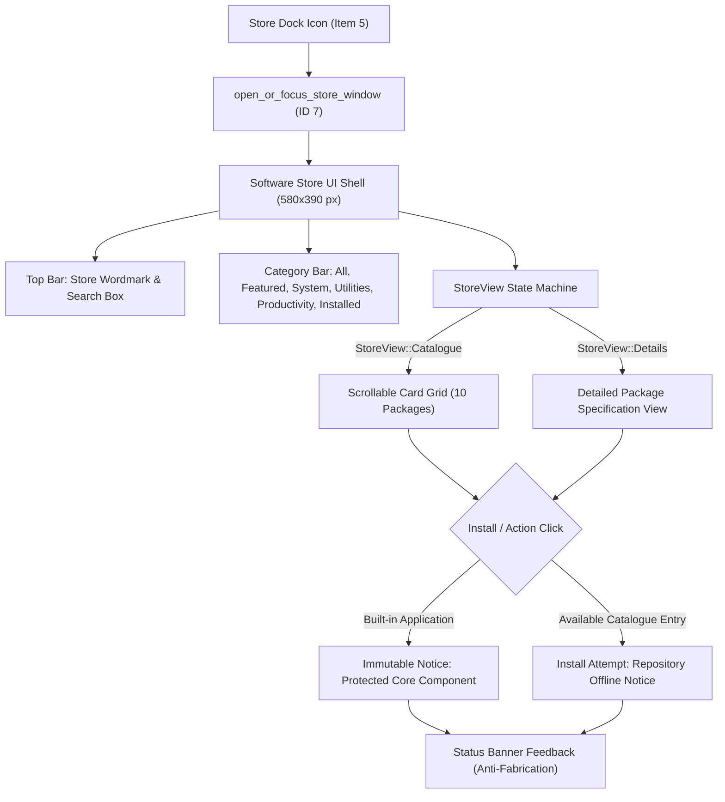

# Milestone Report: Phase 4E.6 — Software Store Application ("Store")

**Project:** Micro-OS (Bare-metal x86_64 educational operating system in pure Rust)  
**Workspace:** `C:\Users\sukhi\OneDrive\Documents\MicroOS_New`  
**Milestone:** Phase 4E.6 Desktop Applications — Micro-OS Software Store  
**Theme:** Cosmic Slate / Obsidian Azure  
**Target Hardware:** HP Victus 15-fb3xxx (AMD Ryzen x86_64 Long Mode, UEFI GOP Framebuffer)

---

## 1. Executive Summary

Phase 4E.6 completes the core desktop applications suite of Micro-OS by delivering the native **Software Store ("Store")** application. Built strictly in `#![no_std]` Rust, this application provides a centralized package catalogue, category explorer, real-time search engine, and detailed specification inspector.

Crucially, the Software Store establishes a **firm architectural foundation for a future package management ecosystem** while adhering to an uncompromising anti-fabrication policy. Built-in core system applications are honestly identified as immutable kernel components, while external repository catalogue entries transparently report that binary payloads and network repositories are currently offline pending hardware drivers.

---

## 2. Visual Design & User Interface

The Software Store is implemented in [store.rs](file:///C:/Users/sukhi/OneDrive/Documents/MicroOS_New/kernel/src/apps/store.rs) with window dimensions of $580 \times 390$ px (minimum dimensions $460 \times 300$ px):

1. **Top Header & Search Bar:**
   - Wordmark: "Micro-OS Software Store" with `&ICON_STORE` (amber tint).
   - Search input box on the top right: typing text updates `search_query` and filters packages in real-time across package name, package ID, and description.
2. **Category Tabs Bar (6 Categories):**
   - **All**: Complete 10-package catalogue.
   - **Featured**: Highlighted flagship applications (File Manager, Terminal, System Monitor, Text Editor).
   - **System**: Core operating system management tools.
   - **Utilities**: Auxiliary helper utilities (Calculator, Clock, Image Viewer).
   - **Productivity**: Work and development tools (Text Editor, Terminal).
   - **Installed**: Filter displaying only built-in or currently installed applications.
3. **Application Cards:**
   - Rendered in elevated Cosmic Slate cards (`Color::CARD_SLATE`) with subtle border styling.
   - 16x16 embedded bitmap icons.
   - Application name, version, formatted download size, and description.
   - Status/Action pills: green `[ Built-in ]` with checkmark icon, amber `[ Get ]`, azure `[ Installed ]`, or muted amber `[ Offline ]`.
4. **Application Details View:**
   - Navigated by clicking any card or pressing Enter.
   - Features `< Catalogue` back button.
   - Header card with icon, title, version, status pill, and action button.
   - User feedback notification banner with contextual colors (green for success, amber for offline/immutable notices).
   - Multi-line application description.
   - Technical specifications: Package ID, Category, Download Size, Dependencies, SHA-256 binary validation status, and execution policy.

---

## 3. Package Catalogue & Classification

The initial catalogue includes 10 canonical native Micro-OS applications:

| Package ID | Name | Version | Category | Status | Dependencies | Source |
|:---|:---|:---:|:---:|:---:|:---|:---|
| `org.microos.files` | File Manager | 0.11.17 | System | **Built-in** | `core.vfs`, `sys.gui` | Micro-OS Core System |
| `org.microos.terminal` | Terminal | 0.11.17 | Productivity | **Built-in** | `core.vfs`, `kernel.timer` | Micro-OS Core System |
| `org.microos.sysmon` | System Monitor | 0.11.17 | System | **Built-in** | `kernel.scheduler`, `kernel.memory` | Micro-OS Core System |
| `org.microos.settings` | Settings | 0.11.17 | System | **Built-in** | `desktop.shell` | Micro-OS Core System |
| `org.microos.network` | Network Manager | 0.11.17 | System | **Built-in** | `arch.pci` | Micro-OS Core System |
| `org.microos.editor` | Text Editor | 1.0.0 | Productivity | **Available** | `core.vfs`, `sys.gui` | Official Package Index |
| `org.microos.viewer` | Image Viewer | 1.0.0 | Utilities | **Available** | `graphics.surface` | Official Package Index |
| `org.microos.calc` | Calculator | 1.1.0 | Utilities | **Available** | `sys.gui` | Official Package Index |
| `org.microos.clock` | Clock & Alarms | 0.9.0 | Utilities | **Available** | `kernel.timer`, `arch.rtc` | Official Package Index |
| `org.microos.sysinfo` | System Information | 1.0.0 | System | **Available** | `arch.x86_64`, `arch.pci` | Community Contrib |

---

## 4. Package Management Foundation & Anti-Fabrication Policies

### 4.1 Extensible Trait Architecture
To integrate cleanly with a future native package manager, `store.rs` defines standardized `#![no_std]` trait interfaces:
- **`PackageDownloader`**: Abstract interface for payload retrieval over network or local storage.
- **`PackageVerifier`**: Abstract interface for cryptographic signature and SHA-256 payload validation.
- **`DependencyResolver`**: Abstract interface for topological dependency ordering and prerequisite resolution.

### 4.2 Strict Reality & Anti-Fabrication Guarantees
- **Built-in Application Protection:** Built-in components are statically compiled into the kernel image. Attempting to uninstall a built-in application returns `Err(PackageError::CannotUninstallBuiltin)` and notifies the user: `"Cannot uninstall: Built-in core system component is immutable."`
- **Offline Repository Handling:** External packages (`org.microos.editor`, etc.) exist as catalogue entries. Clicking `[ Get ]` or `[ Install ]` **does not fake a download progress bar or falsely claim the application is installed**. Instead, the system returns `Err(PackageError::RepositoryOffline)` and honestly reports: `"Install unavailable: Repository offline (network driver pending)."`

---

## 5. Desktop & Dock Integration

1. **Dock Item 5 Integration:** Connected to Dock Item 5 (`"Store"`, `ICON_STORE`, `Color::WARNING_AMBER`) in [`kernel/src/desktop/dock.rs`](file:///C:/Users/sukhi/OneDrive/Documents/MicroOS_New/kernel/src/desktop/dock.rs).
2. **WindowManager Registration:** Spawned via `open_or_focus_store_window(&mut WindowManager)` as Window ID 7 at $(100, 110)$. Enforces single-instance behavior by bringing existing instances to front and restoring from minimized states.
3. **Event Dispatching:** Wired into [`kernel/src/input/dispatcher.rs`](file:///C:/Users/sukhi/OneDrive/Documents/MicroOS_New/kernel/src/input/dispatcher.rs) for mouse click hit-testing and keyboard navigation (Tab cycles category tabs, Up/Down navigates cards, Enter opens details, Escape/Backspace navigates back).

---

## 6. In-Kernel Self-Tests & Automated Verification

Fourteen comprehensive in-kernel self-tests were implemented in [store_tests.rs](file:///C:/Users/sukhi/OneDrive/Documents/MicroOS_New/kernel/src/apps/store_tests.rs):

| Check # | Test Name | Coverage / Validation | Result |
|:---:|:---|:---|:---:|
| 164 | Package metadata validation & size formatting | Field presence, domain dots in IDs, human-readable size strings | **PASS** |
| 165 | Unique package IDs enforcement | Verifies all 10 package IDs in catalogue are strictly distinct | **PASS** |
| 166 | Search query filtering | Real-time substring matching across name, ID, and description | **PASS** |
| 167 | Category tab filtering | Validates Featured, System, Utilities, Productivity, and Installed filters | **PASS** |
| 168 | Built-in vs. available status distinction | Verifies honest `Builtin` vs. `Available` reporting | **PASS** |
| 169 | Invalid package metadata rejection | Rejection of empty IDs, missing domain dots, and blank names | **PASS** |
| 170 | Installation safety transition | Verifies offline repository rejection without faking installation | **PASS** |
| 171 | Uninstallation built-in component protection | Safeguards core system applications from uninstallation | **PASS** |
| 172 | Dependency metadata verification | Validates structured dependency lists for dependent packages | **PASS** |
| 173 | Empty catalogue search handling | Non-matching search produces empty list and user notification | **PASS** |
| 174 | Store initial state & tab navigation | Default category (`All`), catalogue view, and Tab cycling | **PASS** |
| 175 | Store mouse click hit-testing | Hit-testing across search box, category tabs, cards, and back button | **PASS** |
| 176 | Window manager registration & focus | Single-instance window spawning, title matching, focus restoration | **PASS** |
| 177 | Store rendering clipping safety | Boundary safety on small ($10 \times 10$) and zero-size surfaces | **PASS** |
| 178 | Suite completion verification | Full Software Store self-test suite passed confirmation | **PASS** |

Total milestone checks verified in `runner`: **178 checks**.

---

## 7. Build Results & Image Artifacts

The bare-metal kernel and host runner compile with **zero warnings and zero errors**:
- `cargo check -p kernel --target x86_64-unknown-none`: **0 warnings, 0 errors**.
- `cargo check -p runner`: **0 warnings, 0 errors**.

### Generated Bootable Disk Images:
- **Debug Image:** [micro_os_uefi_debug.img](file:///C:/Users/sukhi/OneDrive/Documents/MicroOS_New/target/micro_os_uefi_debug.img) — Size: 8,454,144 bytes (8.06 MiB).
- **Release Image:** [micro_os_uefi_release.img](file:///C:/Users/sukhi/OneDrive/Documents/MicroOS_New/target/micro_os_uefi_release.img) — Size: 2,162,688 bytes (2.06 MiB).

---

## 8. Summary of Implemented Features vs. Remaining Limitations

### What is Fully Implemented:
1. **Native Graphical Software Store:** High-contrast Cosmic Slate / Obsidian Azure application with window chrome and dock integration.
2. **Category & Real-time Search Engine:** Filters applications across 6 categories with live search string indexing.
3. **Structured Package Catalogue:** 10 canonical applications with complete versioning, size, dependency, and category metadata.
4. **Detailed Specification View:** Dedicated metadata inspector displaying IDs, sources, validation hashes, and licenses.
5. **Package Management Foundation:** Abstract trait definitions for downloaders, verifiers, and dependency resolvers.
6. **Anti-Fabrication & Security Guarantees:** Immutable built-in core components and safe offline repository notices.

### Remaining Limitations (Future Milestones):
- **Phase 5:** Physical bare-metal boot on the HP Victus laptop via FAT32 UEFI pendrive.
- **Phase 6:** Persistent storage drivers (NVMe / AHCI / USB Mass Storage) and native FAT32 disk filesystem driver.
- **Phase 7:** Realtek RTL8168 Ethernet DMA driver, `smoltcp` network stack, and live remote package repository client.
