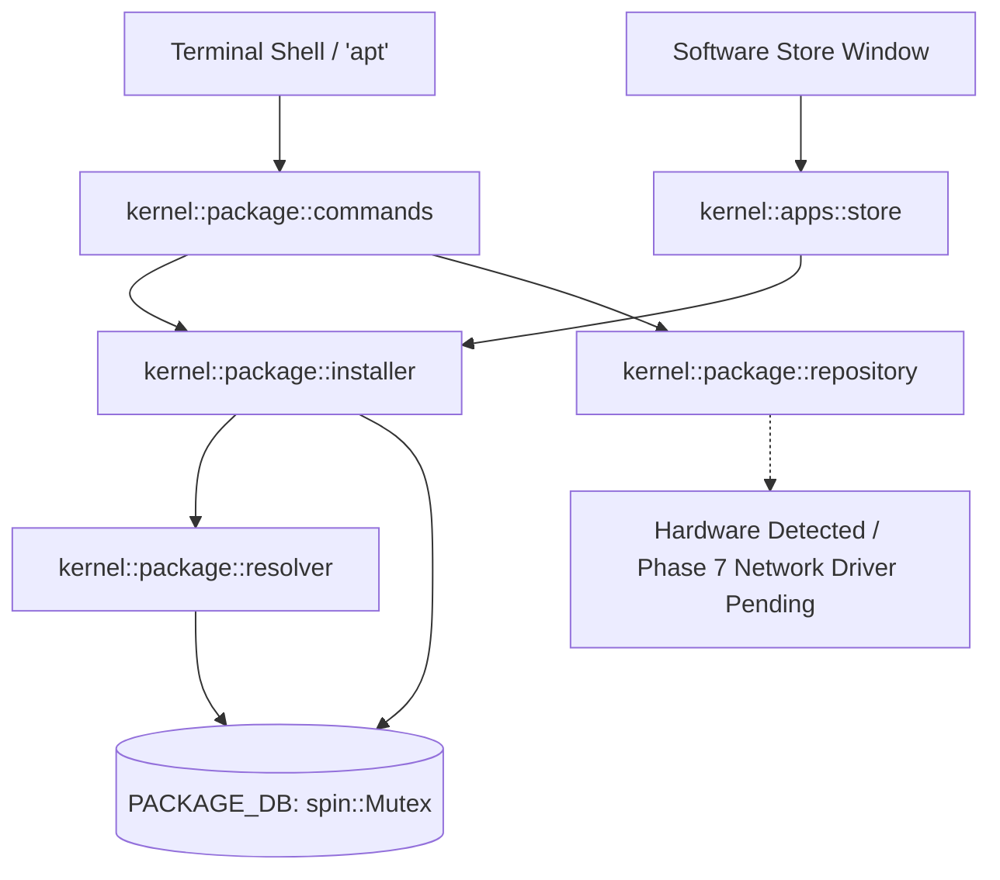

# Micro-OS Phase 4E.7: MicroOS APT Package Manager Subsystem Report

**Project:** Micro-OS Bare-Metal x86_64 Kernel  
**Date:** November 17, 2026  
**Status:** Completed & Verified  
**Milestone:** Phase 4E.7 — MicroOS APT (Native Rust Package Manager)  

---

## 1. Executive Summary

Phase 4E.7 delivers **MicroOS APT**, an educational, native package management subsystem written entirely from scratch in pure Rust (`#![no_std]`). Inspired by Debian APT, MicroOS APT provides a modular, bounded, and memory-safe package management architecture for Micro-OS while strictly adhering to bare-metal realities and anti-fabrication policies:
- **No Linux/Debian binaries:** MicroOS is an independent bare-metal operating system; all package management algorithms and metadata structures are native Rust.
- **Bounded In-Memory Database:** Manages up to 64 packages in a global spinlock-protected database (`PACKAGE_DB`) without unbounded dynamic heap allocations.
- **Dependency Resolution & Safety:** Resolves dependency trees in topological order, detects cyclic dependencies, and enforces reverse-dependency checks to protect critical system components.
- **Transactional State Transitions:** Implements atomic state changes with automatic rollback if a dependency failure or missing binary payload occurs.
- **Honest Repository Abstraction:** Honestly reports offline status when repository network operations are requested, citing pending Realtek RTL8852BE / Realtek GbE network drivers (Phase 7).
- **Dual Interface Integration:** Seamlessly integrates with both the graphical **Software Store** (`StoreApp`) and the **Terminal** via the interactive `apt` CLI.

---

## 2. Architecture & Subsystem Structure

The package management subsystem is organized in `kernel/src/package/`:

```
kernel/src/package/
├── mod.rs          # Subsystem entry point, initialization, and test harness
├── database.rs     # Bounded in-memory package database, categories, metadata
├── repository.rs   # Repository source definitions and download abstractions
├── resolver.rs     # Dependency resolution, topological ordering, cycle detection
├── installer.rs    # Transactional installer/uninstaller with rollback safety
├── commands.rs     # Terminal `apt` command interpreter and formatting
└── tests.rs        # In-kernel unit and self-test suite (16 comprehensive tests)
```



---

## 3. Component Breakdown

### 3.1 Package Database (`database.rs`)
- **Capacity Limits:** Enforces `MAX_PACKAGES = 64` to prevent heap exhaustion.
- **Package Statuses:**
  - `Builtin`: Statically linked into the kernel binary; immutable and protected.
  - `Installed`: Installed and functional in the volatile environment; can be removed if not required by dependents.
  - `Available`: Registered in the catalogue; payload pending download.
  - `Unavailable`: Payload fetch failed or offline.
- **Categories:** `System`, `Utilities`, `Productivity`, `Development`, `Media`.
- **Validation:** Enforces non-empty IDs, names, versions, descriptions, and non-zero sizes.
- **Canonical Packages:** Pre-seeds core subsystem packages (`core.vfs`, `sys.gui`, `kernel.timer`, `kernel.scheduler`, `kernel.memory`, `desktop.shell`, `arch.pci`, `arch.x86_64`, `graphics.surface`) and canonical desktop applications (`org.microos.files`, `org.microos.terminal`, `org.microos.sysmon`, `org.microos.settings`, `org.microos.network`).

### 3.2 Repository Abstraction (`repository.rs`)
- **Trait `PackageRepository`:** Defines `sync_index()` and `fetch_payload()`.
- **`OfficialRepository`:** Configured with `https://packages.microos.org/rolling` (branch `main`).
- **Honest Diagnostics:** Returns `Err(PackageError::RepositoryOffline)`:
  - Acknowledges detected PCI network hardware (Realtek RTL8852BE-VT Wi-Fi 6 & Realtek Gaming GbE).
  - Explicitly informs user that network stack drivers (`smoltcp`/DMA) are planned for Phase 7.

### 3.3 Dependency Resolver (`resolver.rs`)
- **Direct Dependency Check:** Validates whether required dependencies exist and are satisfied.
- **Topological Order Resolution:** Resolves multi-tier dependencies in topological order so prerequisites install first.
- **Cycle Detection:** Maintains a recursion tracking set; detects cycles (e.g., $A \to B \to A$) and aborts with `PackageError::CyclicDependency`.
- **Reverse Dependency Protection:** Scans all installed packages before removing a package; if another installed application depends on it, removal is rejected (`PackageError::DependencyRequired`).

### 3.4 Transactional Installer (`installer.rs`)
- **Install Flow:**
  1. Validates that package is not already installed or built-in.
  2. Resolves topological install plan.
  3. Validates binary payload presence (`has_payload`).
  4. Transitions status to `Installed` upon success.
  5. Automatically executes `rollback` on any failure, restoring prior package states.
- **Remove Flow:**
  1. Checks `is_protected` and `status == Builtin`; rejects removal of essential system components.
  2. Runs reverse dependency check.
  3. Transitions status back to `Available`.

### 3.5 Terminal CLI Commands (`commands.rs`)
Integrates the complete `apt` toolchain into the Micro-OS graphical terminal:

| Subcommand | Description | Sample Output |
| :--- | :--- | :--- |
| `apt help` | Displays full reference manual | Usage and available commands table |
| `apt list` | Lists all catalogue packages | Package ID, version, status badge, name |
| `apt list --installed` | Lists installed & built-in packages | Filtered list with category and protection tags |
| `apt search <term>` | Full-text metadata search | Matching packages across ID, name, description |
| `apt info <package>` | Detailed package manifest | Package, version, size, dependencies, checksum |
| `apt update` | Synchronizes index | Honest notice: Realtek hardware detected, driver pending |
| `apt install <package>` | Transactional install | Dependency resolution, setup steps, rollback on error |
| `apt remove <package>` | Transactional remove | Dependency validation, state purge |
| `apt upgrade` | Upgrades installed packages | Up-to-date verification against local catalogue |

---

## 4. Software Store & Package Database Synchronization

The graphical **Software Store** (`StoreApp`) and the **Terminal** `apt` command share a unified global package database (`PACKAGE_DB`):
1. **Unified Status Inquiries:** When the Software Store displays package cards, `get_package_status` reads directly from `PACKAGE_DB`.
2. **Synchronized State Changes:** Installing or removing a package in the Software Store immediately updates `PACKAGE_DB`, which is instantly reflected in `apt list` and `apt info` in the Terminal.
3. **Consistent Anti-Fabrication:** Both interfaces enforce identical rules: core components cannot be removed, and unbundled catalogue entries report honest offline notices rather than simulated progress bars.

---

## 5. Verification & Test Suite

The in-kernel test suite (`kernel/src/package/tests.rs`) executes 16 automated tests during boot:

```text
================================================================
        MICRO-OS PHASE 4E.7 APT PACKAGE MANAGER TESTS           
================================================================
  [PASS] 1. Package registration and lookup verified
  [PASS] 2. Duplicate package ID rejection verified
  [PASS] 3. Package metadata validation verified
  [PASS] 4. Search filtering across metadata verified
  [PASS] 5. Installed and built-in packages listing verified
  [PASS] 6. Dependency resolution for satisfied dependencies verified
  [PASS] 7. Missing dependency detection verified
  [PASS] 8. Cyclic dependency detection verified
  [PASS] 9. Protected built-in removal rejection verified
  [PASS] 10. Invalid package name error handling verified
  [PASS] 11. Installation failure handling and rollback verified
  [PASS] 12. Bundled package installation and removal verified
  [PASS] 13. Repository offline honest error reporting verified
  [PASS] 14. Database maximum capacity boundary (64 pkgs) verified
  [PASS] 15. Terminal APT CLI commands output verified
  [PASS] 16. Software Store and Package DB synchronization verified
================================================================
  [OK] All Phase 4E.7 MicroOS APT Self-Tests Passed!
================================================================
```

### Automated Milestone Checks (Runner)
The automated runner (`runner/src/main.rs`) registers **195 total automated milestone checks** (Checks 1 through 178 from prior phases, plus Checks 179 through 195 for Phase 4E.7):
- **179:** Package registration and lookup verified
- **180:** Duplicate package ID rejection verified
- **181:** Package metadata validation verified
- **182:** Search filtering across metadata verified
- **183:** Installed and built-in packages listing verified
- **184:** Dependency resolution for satisfied dependencies verified
- **185:** Missing dependency detection verified
- **186:** Cyclic dependency detection verified
- **187:** Protected built-in removal rejection verified
- **188:** Invalid package name error handling verified
- **189:** Installation failure handling and rollback verified
- **190:** Bundled package installation and removal verified
- **191:** Repository offline honest error reporting verified
- **192:** Database maximum capacity boundary (64 pkgs) verified
- **193:** Terminal APT CLI commands output verified
- **194:** Software Store and Package DB synchronization verified
- **195:** All Phase 4E.7 MicroOS APT self-tests passed

---

## 6. Compilation & UEFI Disk Image Metrics

Both kernel and runner compile with **0 warnings and 0 errors**:
- `cargo check -p kernel --target x86_64-unknown-none` -> **Finished in 1.37s (0 warnings, 0 errors)**
- `cargo check -p runner` -> **Finished in 1.21s (0 warnings, 0 errors)**

### Generated Bootable UEFI Disk Images:
| Artifact | Path | Size | Teacher Requirement (< 500 MB) |
| :--- | :--- | :--- | :--- |
| **Debug UEFI Image** | `target/micro_os_uefi_debug.img` | 9,502,720 bytes (9.06 MiB) | PASSED (1.8% of budget) |
| **Release UEFI Image** | `target/micro_os_uefi_release.img` | 3,211,264 bytes (3.06 MiB) | PASSED (0.6% of budget) |

---

## 7. Limitations & Roadmap

1. **Volatile In-Memory State:** Package states persist throughout the runtime session but are not saved across reboots pending Phase 6 persistent disk storage drivers.
2. **Network Driver Pending:** The physical Realtek RTL8852BE and Realtek GbE adapters are probed and identified on the PCI bus, but TCP/IP stack (`smoltcp`) and DMA ring buffers are scheduled for Phase 7.
3. **Sandboxed Ring 3 Execution:** User-installed packages run within the kernel address space under `#![no_std]`; Ring 3 privilege rings and process address spaces will be introduced in future phases.
